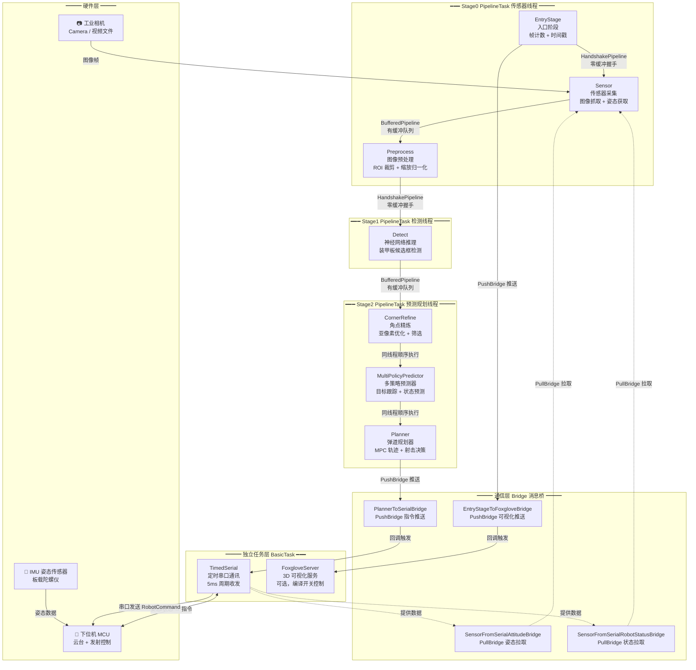

# Auto-Aim —— 自瞄系统

## 简介

本项目是上海科技大学 RoboMaster 战队的自瞄（自动瞄准）系统，用于 **RoboMaster 机甲大师赛**。系统从相机/视频获取图像，通过神经网络检测敌方装甲板，利用卡尔曼滤波跟踪目标运动状态，最终通过模型预测控制（MPC）生成云台控制指令，经串口发送给下位机（MCU）执行瞄准和射击。

- **目标硬件**：NVIDIA Jetson NX（TensorRT 后端） / 爱芯元智 AX650N（AXCL 后端）
- **系统环境**：Ubuntu 18.04/20.04 (ARM64)，gcc/g++ 9+
- **依赖库**：OpenCV 4、Eigen3、CUDA/TensorRT（或 ONNX Runtime / AXCL）

---

## 整体数据流架构



### 数据流说明

| 管道 | 类型 | 方向 | 作用 |
|---|---|---|---|
| **Stage0 → Stage1** | `HandshakePipeline`（零缓冲握手） | EntryStage → … → Detect | 严格同步，生产者等待消费者取走后才发下一帧，防止数据积压导致延迟失控 |
| **Stage1 → Stage2** | `BufferedPipeline`（有缓冲队列） | Detect → CornerRefine → … | 允许少量缓冲，容忍检测和预测的速度差异 |
| **Stage2 → 串口** | `PushBridge`（消息桥推模式） | Planner → TimedSerial | 事件驱动，有新指令立即推送，每 2ms 规划一次 |
| **串口 → Stage0** | `PullBridge`（消息桥拉模式） | TimedSerial → Sensor | 按需查询，Sensor 每帧主动拉取最新 IMU 姿态和裁判系统状态 |

---

## 架构核心概念

### PipelineTask / SubModule / BasicTask 三层架构

```
BasicTask（独立任务，自己管理线程）
  ├── TimedSerial          ← 独立线程，定时串口收发
  └── FoxgloveServer       ← 独立线程，WebSocket 可视化

PipelineTask（流水线容器，管理 SubModule）
  ├── Stage0 线程
  │     ├── EntryStage     ← SubModule
  │     ├── Sensor         ← SubModule
  │     └── Preprocess     ← SubModule
  ├── Stage1 线程
  │     └── Detect         ← SubModule
  └── Stage2 线程
        ├── CornerRefine   ← SubModule
        ├── MultiPolicyPredictor ← SubModule
        └── Planner        ← SubModule

SubModule（功能单元，不管理线程，被 PipelineTask 拥有）
  - 只有 process(data, parent) 一个核心函数
  - 从 ThreadDataPack 读输入，写回输出
  - 不关心上下游是谁，可即插即用
```

### Bridge（消息桥）通信模式

用于**不同线程之间**的解耦通信，发送方和接收方只认识 Bridge，互不知道对方存在。

| 类型 | 类比 | 谁主动 | 本项目用途 |
|---|---|---|---|
| **PushBridge** | 微信公众号推送 | 发送方 push | Planner 推送指令给 TimedSerial |
| **PullBridge** | 公告栏 | 接收方 pull | Sensor 从 TimedSerial 拉取姿态/状态 |

> ⚠️ 安全约定：Bridge 没有内部锁（追求极致性能），回调只能在初始化阶段设置一次，运行期间严禁修改。

---

## 目录结构

```
.
├── CMakeLists.txt                      # 顶层 CMake 构建脚本
├── build.sh                            # 编译脚本（make -j6）
├── launch.cfg                          # 📝 运行配置文件（所有模块参数入口）
├── install_service.py                  # systemd 服务安装脚本
├── main.cpp                            # 🚀 系统主入口（生命周期管理、线程创建、依赖注入）
├── main.hpp                            # 全局头文件汇总
│
├── asset/                              # 📦 资源文件
│   ├── camParam/                       # 相机标定参数（17个yml，按摄像头/兵种区分）
│   │   ├── cam_param_hik1_.yml         #   海康1号相机
│   │   ├── cam_param_sentry.yml        #   哨兵相机
│   │   ├── cam_param_infantry4.yml     #   步兵4号相机
│   │   └── ...
│   ├── models/                         # 神经网络模型文件
│   │   ├── SKD250526.axmodel           #   AXCL 后端模型（爱芯元智 NPU）
│   │   ├── SKD250526.onnx              #   ONNX 通用格式模型
│   │   └── SZU0526_...onnx             #   备选 ONNX 模型
│   └── plannerParam/                   # 规划器参数（按兵种区分）
│       ├── planner_param_sentry.yml    #   哨兵
│       ├── planner_param_infantry4.yml #   步兵4号
│       ├── planner_param_hero.yml      #   英雄
│       ├── planner_param_balance.yml   #   平衡步兵
│       └── planner_param_aerial.yml    #   空中机器人
│
├── common/                             # 🧱 通用基础设施层
│   ├── common.hpp                      #   总头文件（聚合所有 common 子模块）
│   ├── datatype.hpp                    #   全局数据类型（RobotStatus, RobotCommand, ThreadDataPack 等）
│   ├── module_config.hpp               #   模块配置基类（DebugOptions：log/显示开关）
│   ├── pipeline.hpp                    #   ⭐ 流水线框架核心
│   │   ├── BasicTask                   #     独立任务基类（start/stop/terminate 生命周期）
│   │   ├── PipelineTask                #     流水线容器（管理 SubModule 注册与执行）
│   │   ├── SubModule                   #     子模块基类（process 虚函数接口）
│   │   ├── BufferedPipeline<T>         #     有缓冲队列管道（生产者-消费者模式）
│   │   └── HandshakePipeline<T>        #     零缓冲握手管道（严格同步）
│   ├── message_bridge.hpp              #   ⭐ 消息桥接系统
│   │   ├── PushBridge<T>               #     推模式桥（sender→callback）
│   │   └── PullBridge<T>               #     拉模式桥（consumer→provider）
│   ├── cmd_parser/                     #   launch.cfg 配置文件解析器
│   ├── log/                            #   日志系统（屏幕+文件双输出）
│   └── timer/                          #   计时与 FPS 统计工具
│
├── entrystage/                         # 🏁 入口阶段模块（Stage0 首个 SubModule）
│   └── entryStage_submodule.hpp/cpp
│       # 职责：帧计数器递增、时间戳记录、向 Foxglove 发送存活信号
│       # 输入：ThreadDataPack（原始帧）
│       # 输出：ThreadDataPack（附加 frame_id + timestamp）
│
├── sensor/                             # 📷 传感器模块（Stage0 SubModule）
│   ├── sensor_submodule.hpp/cpp        #   传感器子模块
│   │   # 职责：从相机/视频读取图像帧；通过 PullBridge 拉取 IMU 姿态和裁判系统状态
│   │   # 输入：PullBridge（姿态+状态） + 硬件图像源
│   │   # 输出：ThreadDataPack（填充 img, attitude, robot_status）
│   ├── cam_wrapper.hpp                 #   视频流抽象基类（WrapperHead）
│   ├── hikcam/                         #   海康工业相机驱动（MVS SDK 封装）
│   │   ├── hikcam_wrapper.hpp/cpp      #     相机采集实现
│   │   └── MvCameraControl.h           #     海康 SDK 头文件
│   └── video/                          #   视频文件读取
│       └── video_wrapper.hpp/cpp       #     离线视频/测试用
│
├── detect/                             # 🔍 检测模块（横跨 Stage0/Stage1/Stage2）
│   ├── preprocess_submodule.hpp/cpp    #   预处理子模块（Stage0）
│   │   # 职责：图像 ROI 提取、缩放到 640×512、归一化
│   │   # 输入：ThreadDataPack（原始图像）
│   │   # 输出：ThreadDataPack（预处理后图像 + DetectInputMap）
│   ├── detect_submodule.hpp/cpp        #   检测子模块（Stage1）
│   │   # 职责：加载模型 → 执行神经网络推理 → 输出候选检测框列表
│   │   # 输入：ThreadDataPack（预处理图像）
│   │   # 输出：ThreadDataPack（bboxes 检测框数组）
│   ├── corner_refine_submodule.hpp/cpp #   角点精炼子模块（Stage2）
│   │   # 职责：对检测框进行亚像素角点提取优化、装甲板尺寸分类（大/小）
│   │   # 输入：ThreadDataPack（检测框 + 原始图像）
│   │   # 输出：ThreadDataPack（精炼后的四角点坐标）
│   ├── armor_corner_optimizer.hpp/cpp  #   装甲板角点优化器（二值化+轮廓分析）
│   ├── backend.hpp                     #   推理后端抽象基类（BackEnd）
│   ├── AXCL/                           #   爱芯元智 AX650N 推理后端
│   ├── ONNX/                           #   ONNX Runtime 推理后端
│   └── TensorRT/                       #   NVIDIA TensorRT 推理后端
│
├── predict/                            # 🎯 预测模块（Stage2 SubModule）
│   ├── MultiPolicyPredictor_submodule.hpp/cpp  # 多策略预测子模块
│   │   # 职责：多目标跟踪、装甲板筛选、PNP 位姿解算、状态预测
│   │   # 内部维护 3 个 Tracker 实例（NUM_TRACKER=3）并行跟踪
│   │   # 输入：ThreadDataPack（角点 + 姿态 + 状态）
│   │   # 输出：ThreadDataPack（跟踪目标 target + 预测计划 plans）
│   └── Tracker.hpp/cpp                 #   目标跟踪器
│       # 两种模型：装甲板模型（线性KF）+ 整车模型（IESEKF）
│       # 根据目标旋转速度自动切换跟踪模型
│       # 状态机：IDLE → DETECTING → TRACKING → TEMP_LOST → IDLE
│
├── planner/                            # 📐 规划器模块（Stage2 SubModule，最后一环）
│   ├── planner_submodule.hpp/cpp       #   规划器子模块
│   │   # 职责：弹道补偿计算、MPC 云台轨迹优化、射击决策、指令生成
│   │   # 四种射击策略：无模型/装甲板模型/整车模型装甲板/整车模型中心
│   │   # 输入：ThreadDataPack（跟踪目标 + 姿态数据）
│   │   # 输出：通过 PushBridge 发送 RobotCommand[] 到 TimedSerial
│   ├── Planner.hpp/cpp                 #   规划器核心算法
│   │   # 弹道重力补偿 + 飞行时间计算
│   │   # TinyMPC 求解器（yaw/pitch 两轴独立优化）
│   │   # 装甲板切换检测 + 射击窗口判断
│   └── tinympc/                        #   微型 MPC 求解库
│       ├── admm.hpp/cpp                #     ADMM 交替方向乘子法优化器
│       ├── codegen.hpp/cpp             #     矩阵运算代码生成（加速）
│       └── tiny_api.hpp/cpp            #     求解器 API 封装
│
├── timedserial/                        # 🔌 定时串口通讯模块（独立 BasicTask）
│   ├── timed_serial.hpp/cpp            #   定时串口任务
│   │   # 职责：接收 Planner 指令 → 5ms 定时发送到下位机；接收下位机数据 → 解析姿态/状态
│   │   # 指令插值：维护长度为 10 的命令队列，基于时间戳线性插值
│   │   # 输入：PushBridge（Planner 指令）
│   │   # 输出：PullBridge（姿态 + 裁判系统状态）
│   ├── serial_interface.hpp            #   串口驱动抽象接口（依赖注入，支持 Mock）
│   └── UartIMU/                        #   串口 IMU 驱动实现
│       ├── uart_driver.hpp/cpp         #     真实串口驱动（Linux /dev/tty*）
│       ├── mock_driver.hpp             #     模拟驱动（无硬件调试用）
│       └── packet.hpp                  #     数据包协议定义
│
├── mathutils/                          # 📊 数学工具库
│   ├── CoordTransformer.hpp/cpp        #   坐标变换器（单例模式）
│   │   # 三大坐标系：Camera（相机） → IMU（云台） → World（世界）
│   │   # PnP 位姿解算（SolvePNP）
│   │   # 支持装甲板模型：小块 13.5cm×5.6cm / 大块 22.8cm×5.6cm
│   ├── math_tools.hpp                  #   数学工具函数（距离计算、角度归一化等）
│   ├── ExtendedKalman.hpp              #   扩展卡尔曼滤波器
│   ├── IESEKF.hpp                      #   迭代扩展状态卡尔曼滤波器（整车模型用）
│   ├── IESEKF_Double_Armor.hpp         #   双装甲板 IESEKF
│   └── Kalman.hpp                      #   线性卡尔曼滤波器（装甲板模型用）
│
├── foxglove/                           # 🖥️ Foxglove 3D 可视化（可选）
│   └── foxglove_server.hpp/cpp
│       # 职责：WebSocket 服务器，实时推送机器人状态、3D 场景、TF 坐标变换
│       # 输入：PushBridge 从 EntryStage 接收状态
│       # 编译开关：cmake -DENABLE_FOXGLOVE=ON
│
├── thirdparty/                         # 第三方预编译库
│   ├── foxglove_arm64/                 #   Foxglove SDK ARM64 版
│   └── foxglove_x64/                   #   Foxglove SDK x64 版
│
├── tools/                              # 🛠️ Python 调试/分析工具
│   ├── 2d_point_show.py                #   2D 特征点可视化
│   ├── 3d_point_show.py                #   3D 点云可视化
│   ├── data_plotter.py                 #   运行时数据绘图
│   ├── ekf_test.py                     #   卡尔曼滤波器单元测试
│   ├── handeye_calibration.py          #   手眼标定工具
│   ├── pipeline_visualize.py           #   流水线可视化
│   └── predictor_simulation.py         #   预测器仿真测试
│
└── bash/                               # 服务管理脚本
    ├── auto-aim-start.sh               #   启动包装脚本（由 install_service.py 自动生成）
    ├── auto-aim-stop.sh                #   停止脚本（SIGTERM → 8s超时 → SIGKILL）
    └── auto-aim-help.sh                #   帮助信息
```

---

## 各模块详解

### 1. EntryStage（入口阶段）

最简单的 SubModule，只做两件事：
- 给每一帧分配递增的 `frame_id`
- 向 Foxglove 发送存活心跳信号（用于判断系统是否在正常运行）

### 2. Sensor（传感器采集）

- **图像源**：根据 `launch.cfg` 中的 `source` 配置，可以是海康相机索引、视频文件路径
- **姿态/状态**：通过 `PullBridge` 从 `TimedSerial` 拉取最新的 IMU 姿态（yaw/pitch/roll）和裁判系统状态（敌方颜色、弹速、比赛模式等）
- 支持图像翻转（`flip=1`）

### 3. Preprocess（图像预处理）

- 根据检测框 ROI 裁剪原图
- 缩放到固定尺寸 **640×512**
- 归一化处理（适配模型输入格式）

### 4. Detect（神经网络推理）

- 加载模型文件（`.axmodel` / `.onnx` / TensorRT engine）
- 执行前向推理
- 输出候选装甲板检测框列表（`bbox_t`：中心坐标、宽高、置信度等）
- 支持三种推理后端切换（AXCL / ONNX / TensorRT）

### 5. CornerRefine（角点精炼）

- 对每个检测框进行亚像素级角点提取
- 基于二值化阈值分析（红色/蓝色不同阈值）
- 区分大小装甲板（通过角点间距判断）
- 筛选有效装甲板，剔除误检

### 6. MultiPolicyPredictor（多策略预测器）

这是预测模块的核心，内部维护 **3 个 Tracker 实例**（可同时跟踪最多 3 个目标）：

- **装甲板模型跟踪**：用线性卡尔曼滤波跟踪单个装甲板的 (x, y, z) 坐标
- **整车模型跟踪**：用迭代扩展卡尔曼滤波（IESEKF）跟踪敌方机器人的旋转中心和旋转速度
- **自动切换**：根据目标的旋转速度自动选择合适的模型
- **状态机**：
  ```
  IDLE（空闲） → DETECTING（检测中，连续4帧） → TRACKING（跟踪中）
                                                    ↓ 丢失
                                              TEMP_LOST（暂时丢失，30帧超时）
                                                    ↓ 超时
                                                  IDLE
  ```

### 7. Planner（弹道规划器）

自瞄系统的**最后一环**，负责把预测结果转化为可执行的控制指令：

**四种射击策略**（可在 `plannerParam` 中按兵种开关）：
| 策略 | 说明 |
|---|---|
| 无模型跟踪装甲板 | 直接瞄准装甲板当前位置，最简单，延迟最低 |
| 装甲板模型跟踪装甲板 | 基于装甲板运动轨迹预测未来位置 |
| 整车模型跟踪装甲板 | 基于敌方整车旋转模型预测装甲板位置 + MPC 优化云台轨迹 |
| 整车模型瞄准中心 | 瞄准车辆旋转中心，适合高速旋转目标（反陀螺） |

**核心技术**：
- **TinyMPC**（微型模型预测控制）：分别在 yaw 和 pitch 两轴上独立求解最优轨迹，确保云台运动平滑不超调
- **弹道补偿**：考虑重力下坠，修正俯仰角；可选考虑空气阻力
- **射击决策**：瞄准误差 < 0.05 rad（≈2.86°）时允许开火
- **装甲板切换检测**：检测敌方是否切换暴露的装甲板面

### 8. TimedSerial（定时串口通讯）

- **发送**：以 5ms 为周期，将 Planner 发来的 `RobotCommand[]`（10 个指令数组）基于时间戳线性插值后发送给下位机
- **接收**：实时解析下位机上传的 IMU 姿态（yaw/pitch/roll）和裁判系统状态
- **依赖注入**：通过 `SerialInterface` 抽象接口注入驱动，支持真实串口（`UartDriver`）和模拟（`MockDriver`）两种模式

### 9. CoordTransformer（坐标变换器，单例）

管理三大坐标系之间的变换：

```
相机坐标系 (Camera)  →  IMU坐标系 (云台旋转中心)  →  世界坐标系 (World, 欧拉角归零)
       ↑ PnP解算              ↑ 手眼标定外参                   ↑ IMU姿态逆旋转
```

- 从 YAML 文件读取相机内参矩阵和畸变系数
- 从 YAML 文件读取相机到 IMU 的外参矩阵
- 提供 `camera2world()` 等方法进行坐标转换
- 提供重力弹道补偿函数

---

## 编译与运行

### 编译

```bash
# 1. 首次配置 CMake（选择推理后端）
mkdir build && cd build
cmake -DINFERENCE_BACKEND=AXCL ..    # AXCL / ONNX / TRT 三选一

# 可选：开启 Foxglove 可视化
cmake -DINFERENCE_BACKEND=AXCL -DENABLE_FOXGLOVE=ON ..

# 2. 编译
cd ..
bash build.sh                         # 等效于 cd build && make -j6 && cd ..
```

### 运行

```bash
./build/auto-aim                      # 前台运行（调试用）
```

### 安装为系统服务（开机自启）

```bash
sudo python3 install_service.py       # 安装服务 + 注册 bash 别名
source ~/.bashrc                      # 使别名生效

autoaim-enable                        # 启用开机自启
autoaim-start                         # 立即启动
autoaim-stop                          # 停止
autoaim-status                        # 查看状态
```

---

## 配置文件说明（launch.cfg）

```ini
# --- 传感器 ---
source=0                              # 相机索引（0=第一个海康相机）或视频文件路径
port=/dev/ttyS4                       # 串口设备路径（None=使用MockDriver模拟）
imu=UART                              # IMU 类型（UART/BMI，目前仅支持UART）
flip=0                                # 是否翻转图像（1=翻转）

# --- 模型 ---
model=asset/models/SKD250526.axmodel  # 推理模型文件路径

# --- 参数文件 ---
camera_para=asset/camParam/cam_param_hik1_.yml       # 相机标定+外参
planner_para=asset/plannerParam/planner_param_sentry.yml # 规划器参数

# --- 各模块调试开关 ---
# 格式：<模块名>_log_text=true/false    → 终端输出日志
#       <模块名>_log_file=true/false    → 文件输出日志
#       <模块名>_show_image=true/false  → 显示调试画面
entrystage_log_text=false
sensor_log_text=false
preprocess_log_text=false
detect_log_text=false
corner_refine_log_text=false
predictor_log_text=false
planner_log_text=false
planner_plot=false                    # Planner 数据绘图
```

---

## 规划器参数说明（asset/plannerParam/*.yml）

每个兵种有独立参数文件，因为弹道特性和策略不同：

| 参数 | 单位 | 含义 |
|---|---|---|
| `latency` | ms | 系统总延迟（图像采集→推理→预测→规划→串口→云台响应），Planner 据此做前瞻补偿 |
| `single_shoot_latency` | ms | 单发子弹从指令到出膛的延迟 |
| `continue_shoot_latency` | ms | 连发模式两发之间的间隔 |
| `same_trace_threshold` | rad | 弹道跟踪一致性阈值，低于此值认为瞄准稳定可射击 |
| `pitch_comp` | rad | 俯仰角机械安装误差补偿 |
| `yaw_comp` | rad | 偏航角机械安装误差补偿 |
| `disable_vehicle_center_shoot_mode` | 0/1 | 禁用"瞄准车辆中心"策略（反陀螺策略） |
| `disable_armor_with_vehicle_shoot_mode` | 0/1 | 禁用"整车模型跟踪装甲板"策略 |
| `consider_air_resistence` | 0/1 | 弹道计算是否考虑空气阻力 |

---

## 依赖项

| 依赖 | 用途 | 安装方式 |
|---|---|---|
| gcc/g++ 9+ | C++20 编译器 | `apt install gcc-9 g++-9` |
| OpenCV 4 | 图像处理、PnP | `apt install libopencv-dev` |
| Eigen3 | 矩阵运算、KF/EKF | `apt install libeigen3-dev` |
| CUDA 10.2 + TensorRT 8 | NVIDIA 推理后端（NX） | SDK Manager |
| ONNX Runtime | ONNX 推理后端 | 编译安装 |
| AXCL | 爱芯元智 NPU 推理后端 | AX650 SDK |
| MVS | 海康工业相机驱动 | 官网下载 |
| Foxglove SDK | 3D 可视化（可选） | 预编译在 `thirdparty/` |

---

## FAQ

- **MVS 安装后**需要在 `~/.bashrc` 中设置 `MVS_PATH` 指向 `libMvControl.so` 所在目录
- **gcc/g++ 版本不对**时会出现 `filesystem` 相关编译错误，需升级到 gcc-9/g++-9
- **AX650 平台**可使用一键配置脚本：[SHtech_auto_aim_AX650-EnvCfg](https://github.com/Astra-Whale/SHtech_auto_aim_AX650-EnvCfg)

---

## 更新日志

- 2021-10-02：代码框架初步搭建
- 2021-11-20：坐标转换封装，静态目标预测
- 2021-12-10：动态目标二阶线性预测
- 2025-02-14：合并推理后端，统一构建脚本
- 2025-11：大规模重构——Pipeline/SubModule/Bridge 架构，引入 TinyMPC 规划器，支持多兵种参数化
- 2026-07：完善文档，修正过时的代码框架说明
